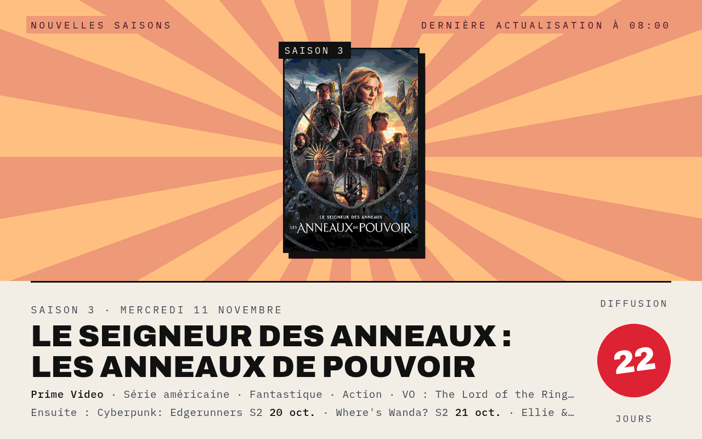
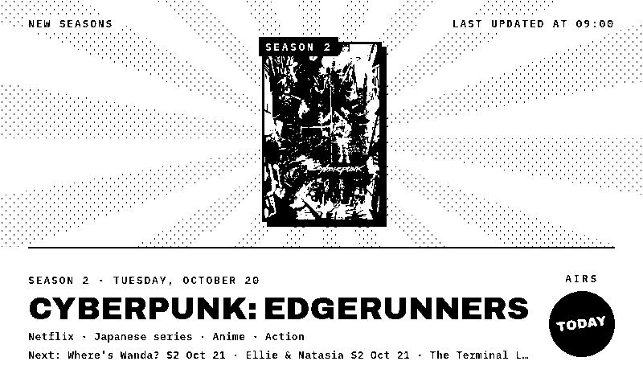
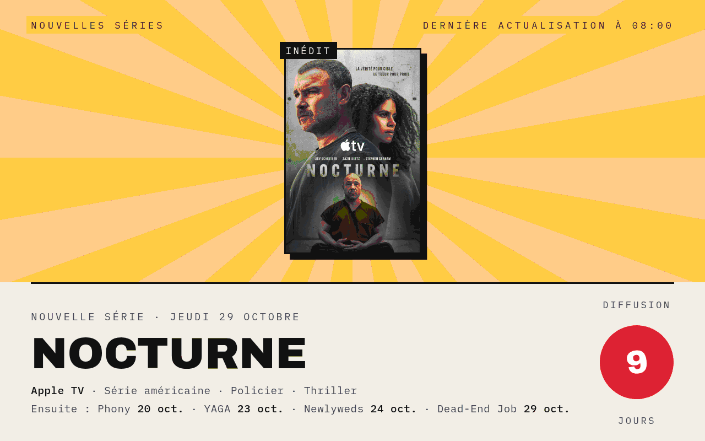
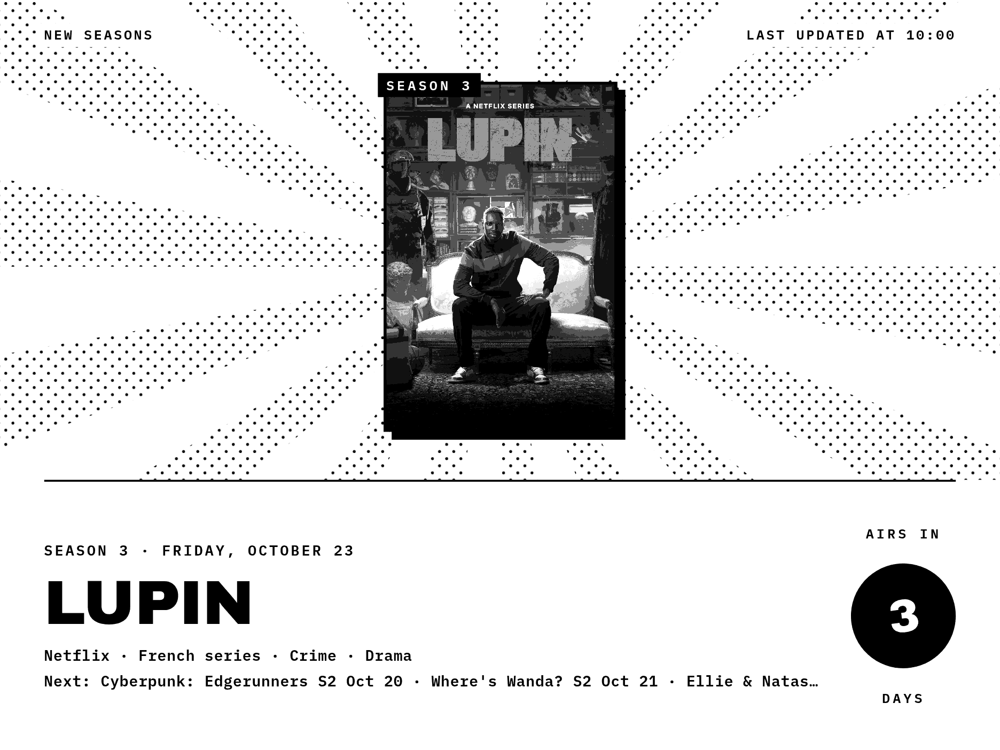
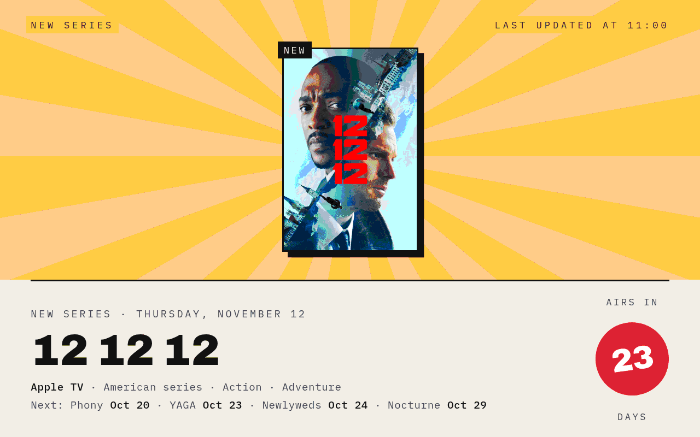
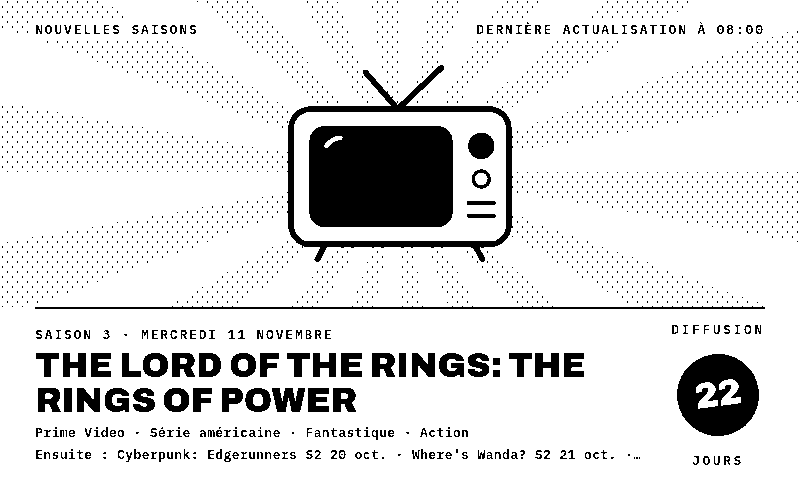

# ShowPoster

**[English](#english) · [Français](#français)**

---

## English

*What to watch next, drawn as a poster.*

A TRMNL plugin that puts one TV series on a poster: the next new seasons and new series, on TV and streaming, with their poster art, their channel or platform and a countdown to the premiere. It is part of the Poster suite with [FlightPoster](https://github.com/BartoX360/FlightPoster), [WeatherPoster](https://github.com/BartoX360/WeatherPoster), [GamePoster](https://github.com/BartoX360/GamePoster), [MoviePoster](https://github.com/BartoX360/MoviePoster) and [BookPoster](https://github.com/BartoX360/BookPoster)and shares their look.

No server to install: the premieres come from the [Trakt](https://trakt.tv) calendar, and the posters and translated titles from [The Movie Database (TMDB)](https://www.themoviedb.org). Both are free.

### Features

- **E-ink and color**: a pure black & white style built for 1-bit screens (TRMNL OG, TRMNL X), and a color style for LCD screens
- **Every layout**: full screen, half horizontal, half vertical and quadrant (mashups)
- **Two sections**, each with its own sky color: *New seasons* (dusk), ranked by the series' Trakt following, and *New series* (gold), ranked by Trakt's most anticipated list
- **Rotation**: every hour the poster moves to another of the top five series and alternates between both sections, or stays on the section you pick
- **Countdown stamp**: the number of days before the premiere, over the next 33 days
- **Channel or platform** (Netflix, Prime Video, Apple TV, HBO…), country of origin, genres, and the next premieres in calendar order
- **Your countries**: only series made in the countries you pick, or all of them; reality TV, game shows, talk shows, news and soaps are left out
- **English or French**: with a TMDB key, titles are translated (the original title is shown next to them)
- Without a TMDB key, or for series without poster art, a vintage TV set is drawn

### Screenshots

| | |
|---|---|
|  |  |
| E-ink · new seasons | Color · new series |
|  |  |
| TRMNL X · new seasons | Color · rotation |
|  |  |
| Half horizontal | Half vertical |

### Installation

> [!NOTE]
> This plugin is built and tested on [LaraPaper](https://github.com/usetrmnl/larapaper) only. It should work on usetrmnl.com and other TRMNL servers, but it has not been tested there: feedback is welcome in the issues.

1. **Trakt**: on [trakt.tv/oauth/applications/new](https://trakt.tv/oauth/applications/new) (free account), create an app with any redirect URI (e.g. `http://localhost/callback`) and no permissions, then copy its **Client ID** (not the secret).
2. **TMDB** (optional, for posters): create a free account on [themoviedb.org](https://www.themoviedb.org/signup), then copy the **API Key** (v3) from [Settings → API](https://www.themoviedb.org/settings/api).
3. **TRMNL (usetrmnl.com)**: create a *Private Plugin* with the *Polling* strategy, then copy:
   - `polling_url` from `recipe/src/settings.yml` into *Polling URL* (two lines, one URL each);
   - `polling_headers` into *Polling Headers*, as `trakt-api-key={{ trakt_id }}&trakt-api-version=2`;
   - the `custom_fields` from `recipe/src/settings.yml` into *Custom fields* (YAML);
   - `recipe/src/shared.liquid` into *Shared markup*, and each `recipe/src/<layout>.liquid` into the matching layout tab.

   The `recipe/src/` folder follows the [trmnlp](https://github.com/usetrmnl/trmnlp) layout.

   **LaraPaper / BYOS**: *Plugins → Import recipe*, pick `showposter-x.y.z.zip` from the [latest release](https://github.com/BartoX360/ShowPoster/releases/latest) (or zip the contents of `recipe/src/`).
4. Fill in your settings, starting with the Trakt Client ID.

### Settings

| Field | Purpose |
|---|---|
| Trakt Client ID | The Client ID of your Trakt app |
| TMDB API key | Optional: posters and translated titles |
| Countries of origin | Series made in any of them; leave blank for all countries |
| Poster | *Rotate* (both sections), or only *New seasons*, or only *New series* |
| Language | English or French (titles with a TMDB key, genres, dates) |
| Style | E-ink (black & white) or Color |

### Development

| File | Purpose |
|---|---|
| `dev/recipe_render.sh <folder>` | Zips the recipe, imports it into LaraPaper as "ShowPoster (test)", renders every test case and copies the PNGs into `<folder>` |
| `dev/recipe_test.php` | The test cases (section, rotation, layout, device, language, no TMDB key, errors, missing key) run inside LaraPaper; the TMDB key is taken from the installed plugin |
| `dev/test_payload.json` | A frozen Trakt premieres calendar (October 20, 2026, 33 days, all countries) and anticipated list used by the test cases |
| `dev/update.php` | Copies the code of "ShowPoster (test)" into the installed plugin, keeping its settings |
| `dev/install.php` | First install: imports the recipe as "ShowPoster"; the keys are then entered in its settings |

The scripts target a LaraPaper server running in Docker (container `larapaper-app-1`) over SSH, set with `LARAPAPER_SSH` (e.g. `root@my-server`) in the environment or in `dev/.env` (ignored by git).

### Notes

- The screen is built with JavaScript at render time, so the renderer must run JavaScript; the poster is looked up on TMDB at render time too.
- Trakt does not allow hotlinking its images, hence the posters from TMDB, which does.
- On e-ink, posters are turned to grayscale and dithered by the renderer.
- Titles not written in the Latin alphabet are left out, as the fonts cannot draw them.
- This product uses the TMDB API but is not endorsed or certified by TMDB.

---

## Français

*Quelle série regarder ensuite, façon affiche.*

Un plugin TRMNL qui met une série à l'affiche : les prochaines nouvelles saisons et nouvelles séries, à la télé et en streaming, avec leur affiche, leur chaîne ou plateforme et un compte à rebours avant la première diffusion. Il fait partie de la suite Poster avec [FlightPoster](https://github.com/BartoX360/FlightPoster), [WeatherPoster](https://github.com/BartoX360/WeatherPoster), [GamePoster](https://github.com/BartoX360/GamePoster), [MoviePoster](https://github.com/BartoX360/MoviePoster) et [BookPoster](https://github.com/BartoX360/BookPoster)dont il reprend le style.

Aucun serveur à installer : les premières viennent du calendrier de [Trakt](https://trakt.tv), les affiches et les titres traduits de [The Movie Database (TMDB)](https://www.themoviedb.org). Les deux sont gratuits.

### Fonctionnalités

- **E-ink et couleur** : un style noir et blanc pur pour les écrans 1 bit (TRMNL OG, TRMNL X) et un style couleur pour les écrans LCD
- **Tous les formats** : plein écran, demi horizontal, demi vertical et quart d'écran (mashups)
- **Deux rubriques**, chacune avec sa couleur de ciel : *Nouvelles saisons* (crépuscule), classées selon le public de la série sur Trakt, et *Nouvelles séries* (doré), classées selon la liste des plus attendues de Trakt
- **Rotation** : chaque heure, l'affiche passe à une autre des cinq premières séries et alterne entre les deux rubriques, ou reste sur la rubrique choisie
- **Tampon** : le nombre de jours avant la diffusion, sur les 33 prochains jours
- **Chaîne ou plateforme** (Netflix, Prime Video, Apple TV, HBO…), pays d'origine, genres et les premières suivantes dans l'ordre du calendrier
- **Vos pays** : seulement les séries des pays choisis, ou toutes ; téléréalité, jeux, talk-shows, infos et feuilletons sont écartés
- **Français ou anglais** : avec une clé TMDB, les titres sont traduits (le titre original s'affiche à côté)
- Sans clé TMDB, ou pour une série sans affiche, un vieux téléviseur est dessiné

### Captures

| | |
|---|---|
|  |  |
| Couleur · nouvelles saisons | E-ink · sans clé TMDB |
|  |  |
| Quart d'écran | Demi horizontal · nouvelles séries |

### Installation

> [!NOTE]
> Ce plugin est développé et testé uniquement sur [LaraPaper](https://github.com/usetrmnl/larapaper). Il devrait fonctionner sur usetrmnl.com et les autres serveurs TRMNL, mais il n'y a pas été testé : les retours sont les bienvenus dans les issues.

1. **Trakt** : sur [trakt.tv/oauth/applications/new](https://trakt.tv/oauth/applications/new) (compte gratuit), créez une app avec n'importe quelle URI de redirection (ex. `http://localhost/callback`) et aucune permission, puis copiez son **Client ID** (pas le secret).
2. **TMDB** (facultatif, pour les affiches) : créez un compte gratuit sur [themoviedb.org](https://www.themoviedb.org/signup), puis copiez la **clé d'API** (v3) depuis [Paramètres → API](https://www.themoviedb.org/settings/api).
3. **TRMNL (usetrmnl.com)** : créez un *Private Plugin* avec la stratégie *Polling*, puis copiez :
   - `polling_url` de `recipe/src/settings.yml` dans *Polling URL* (deux lignes, une URL par ligne) ;
   - `polling_headers` dans *Polling Headers*, sous la forme `trakt-api-key={{ trakt_id }}&trakt-api-version=2` ;
   - les `custom_fields` de `recipe/src/settings.yml` dans *Custom fields* (YAML) ;
   - `recipe/src/shared.liquid` dans *Shared markup*, et chaque `recipe/src/<format>.liquid` dans l'onglet correspondant.

   **LaraPaper / BYOS** : *Plugins → Import recipe*, choisissez `showposter-x.y.z.zip` dans la [dernière release](https://github.com/BartoX360/ShowPoster/releases/latest) (ou zippez le contenu de `recipe/src/`).
4. Remplissez les réglages, à commencer par le Client ID Trakt.

### Réglages

| Champ | Rôle |
|---|---|
| Client ID Trakt | Le Client ID de votre app Trakt |
| Clé d'API TMDB | Facultative : affiches et titres traduits |
| Pays d'origine | Les séries d'au moins l'un d'eux ; vide pour tous les pays |
| Affiche | *Rotation* (les deux rubriques), ou seulement *Nouvelles saisons*, ou seulement *Nouvelles séries* |
| Langue | Français ou anglais (titres avec une clé TMDB, genres, dates) |
| Style | E-ink (noir et blanc) ou Couleur |

### Notes

- L'écran est construit en JavaScript au moment du rendu : le moteur de rendu doit exécuter le JavaScript ; l'affiche est aussi cherchée chez TMDB à ce moment-là.
- Trakt interdit de charger ses images en direct, d'où les affiches de TMDB, qui l'autorise.
- En e-ink, les affiches passent en niveaux de gris, tramés par le moteur de rendu.
- Les titres qui ne s'écrivent pas en alphabet latin sont écartés, faute de glyphes dans les polices.
- Ce produit utilise l'API TMDB mais n'est ni approuvé ni certifié par TMDB.

---

## Licence / License

Code sous licence [MIT](LICENSE). Les données affichées appartiennent à leurs sources respectives. / Code released under the [MIT](LICENSE) license. The data shown belongs to its respective sources.
