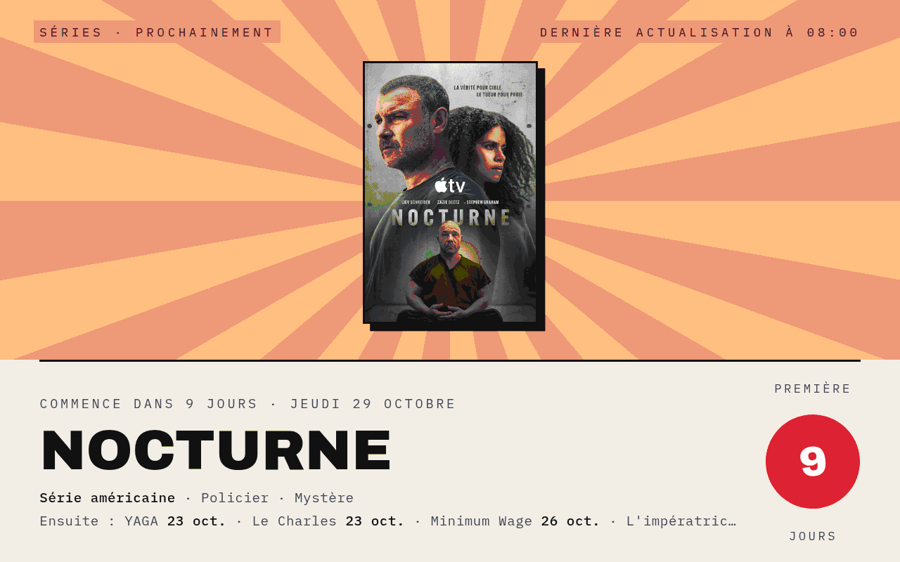
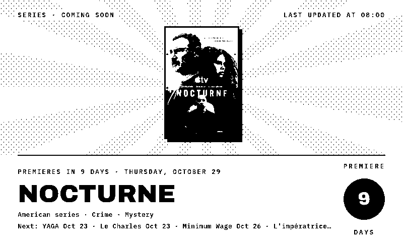
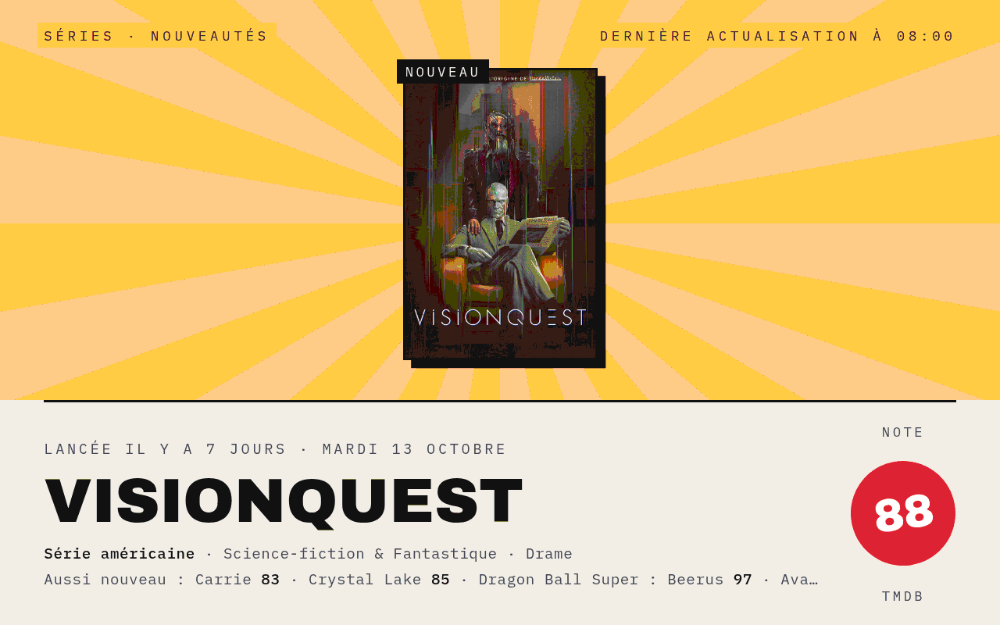
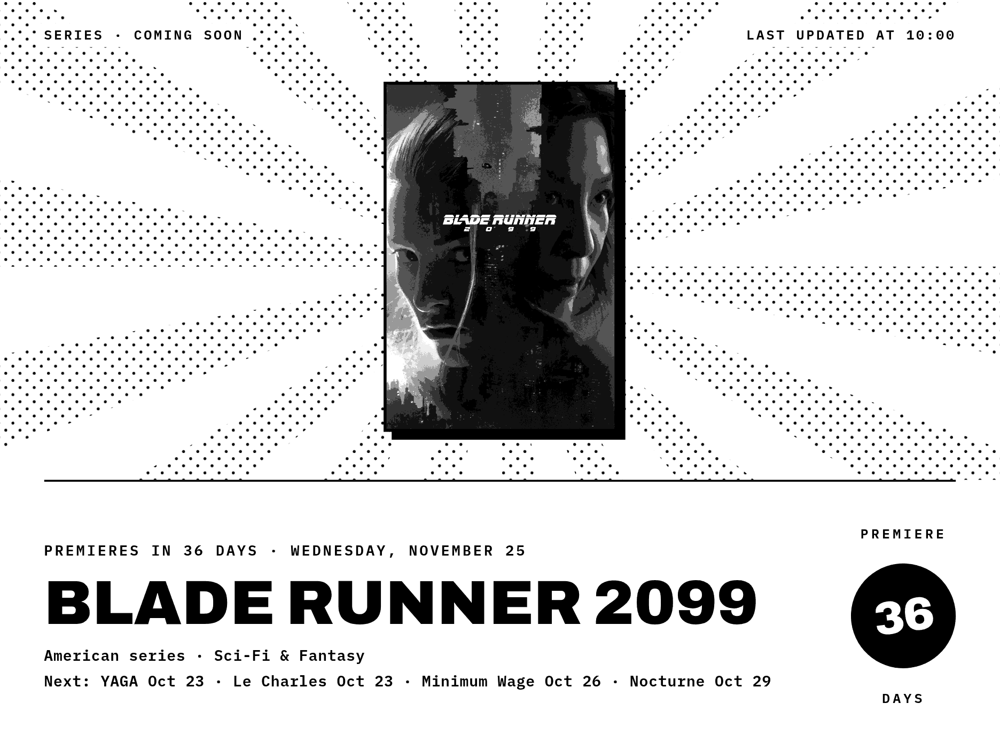
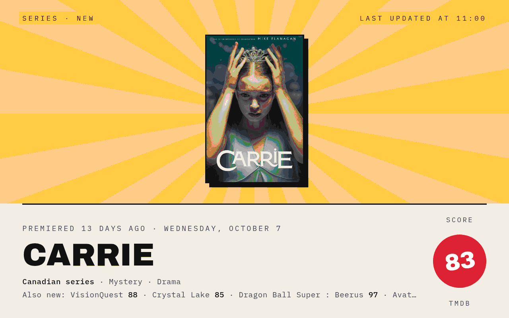
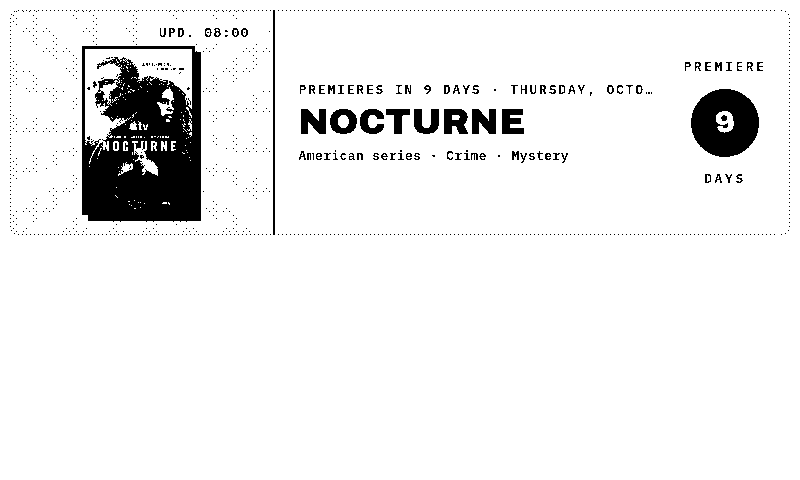
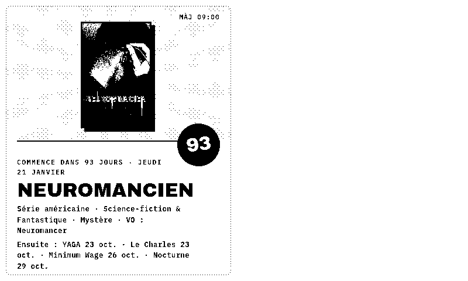
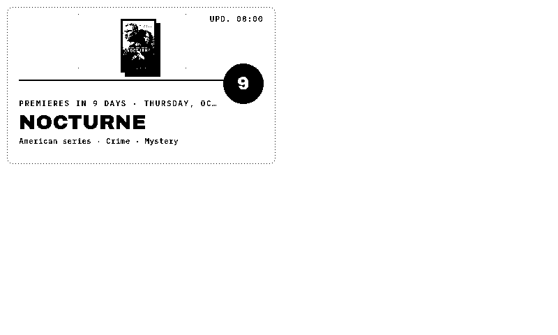
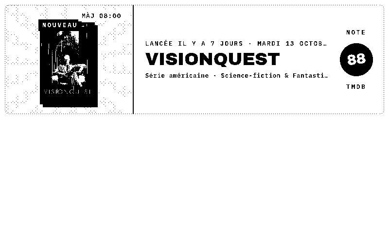

# ShowPoster

**[English](#english) · [Français](#français)**

---

## English

*What to watch next, drawn as a poster.*

A TRMNL plugin that puts one TV series on a poster: the next new series to premiere, or the ones that just started, with their poster art, a countdown to the premiere or the TMDB audience score. It is part of the Poster suite with [GamePoster](http://192.168.1.109:3000/Anthony/GamePoster), [FlightPoster](http://192.168.1.109:3000/Anthony/FlightPoster) and [WeatherPoster](http://192.168.1.109:3000/Anthony/WeatherPoster), and shares their look.

No server to install: the data comes straight from [The Movie Database (TMDB)](https://www.themoviedb.org), with a free API key.

### Features

- **E-ink and color**: a pure black & white style built for 1-bit screens (TRMNL OG, TRMNL X), and a color style for LCD screens
- **Every layout**: full screen, half horizontal, half vertical and quadrant (mashups)
- **Two sections**, each with its own sky color: *Coming soon* (dusk) and *New* (gold), for series that premiered in the last 60 days
- **Rotation**: every hour the poster moves to another of the five most awaited (or most watched) series, and alternates between both sections, or stays on the section you pick
- **Score stamp**: the number of days before the premiere, or the TMDB audience score out of 100
- **Next premieres** listed in calendar order, with country of origin, genres and original title
- **Your countries**: only series made in the countries you pick (United States, United Kingdom, France, Nordic countries, Korea…), or all of them; talk shows, news, reality TV and soaps are left out
- **English or French**
- Series without poster art get a vintage TV set illustration

### Screenshots

| | |
|---|---|
|  |  |
| E-ink · coming soon | Color · new series |
|  |  |
| TRMNL X · coming soon | Color · rotation |
|  |  |
| Half horizontal | Half vertical |

### Installation

1. Create a free account on [themoviedb.org](https://www.themoviedb.org/signup), then copy the **API Key** (v3, not the Read Access Token) from [Settings → API](https://www.themoviedb.org/settings/api).
2. **TRMNL (usetrmnl.com)**: create a *Private Plugin* with the *Polling* strategy, then copy:
   - `polling_url` from `recipe/src/settings.yml` into *Polling URL* (two lines, one URL each);
   - the `custom_fields` from `recipe/src/settings.yml` into *Custom fields* (YAML);
   - `recipe/src/shared.liquid` into *Shared markup*, and each `recipe/src/<layout>.liquid` into the matching layout tab.

   The `recipe/src/` folder follows the [trmnlp](https://github.com/usetrmnl/trmnlp) layout.

   **LaraPaper / BYOS**: *Plugins → Import recipe*, pick `recipe/showposter.zip` (built by `recipe_render.sh`, or zip the contents of `recipe/src/`).
3. Fill in your settings, starting with the TMDB API key.

### Settings

| Field | Purpose |
|---|---|
| TMDB API key | Your free TMDB API key (v3) |
| Countries of origin | Series made in any of them; leave blank for all countries |
| Poster | *Rotate* (both sections), or only *Coming soon*, or only *New* |
| Language | English or French (titles, genres and dates) |
| Style | E-ink (black & white) or Color |

### Development

| File | Purpose |
|---|---|
| `recipe_render.sh <folder>` | Zips the recipe, imports it into LaraPaper as "ShowPoster (test)", renders every test case and copies the PNGs into `<folder>` |
| `recipe_test.php` | The test cases (section, rotation, layout, device, language, missing poster, errors, missing key) run inside LaraPaper |
| `test_payload.json` | Frozen TMDB series lists, all countries (October 20, 2026), used by the test cases |
| `update.php` | Copies the code of "ShowPoster (test)" into the installed plugin, keeping its settings |
| `install.php` | First install: imports the recipe as "ShowPoster"; the API key is then entered in its settings |

### Notes

- The screen is built with JavaScript at render time, so the renderer must run JavaScript.
- Poster art is loaded from TMDB at render time; on e-ink it is turned to grayscale and dithered by the renderer.
- The polling URLs hold today's date: the feed is refetched every hour, and the lists are matched again to the current day at render time.
- Only new series are covered: TMDB lists do not give the date of a new season of an existing series.
- Titles not written in the Latin alphabet (and untranslated) are left out of the poster and the lists, as the fonts cannot draw them; the original title is shown only when it differs.
- In LaraPaper, the half and quadrant layouts render blank on the color (Echo Show) screen model, for every Poster plugin: they are tested on e-ink only.
- This product uses the TMDB API but is not endorsed or certified by TMDB.

---

## Français

*Quelle série regarder ensuite, façon affiche.*

Un plugin TRMNL qui met une série à l'affiche : les prochaines nouvelles séries, ou celles qui viennent de commencer, avec leur affiche, un compte à rebours avant la première ou la note des spectateurs TMDB. Il fait partie de la suite Poster avec [GamePoster](http://192.168.1.109:3000/Anthony/GamePoster), [FlightPoster](http://192.168.1.109:3000/Anthony/FlightPoster) et [WeatherPoster](http://192.168.1.109:3000/Anthony/WeatherPoster), dont il reprend le style.

Aucun serveur à installer : les données viennent directement de [The Movie Database (TMDB)](https://www.themoviedb.org), avec une clé d'API gratuite.

### Fonctionnalités

- **E-ink et couleur** : un style noir et blanc pur pour les écrans 1 bit (TRMNL OG, TRMNL X) et un style couleur pour les écrans LCD
- **Tous les formats** : plein écran, demi horizontal, demi vertical et quart d'écran (mashups)
- **Deux rubriques**, chacune avec sa couleur de ciel : *Prochainement* (crépuscule) et *Nouveautés* (doré), les séries lancées depuis moins de 60 jours
- **Rotation** : chaque heure, l'affiche passe à une autre des cinq séries les plus attendues (ou les plus suivies) et alterne entre les deux rubriques, ou reste sur la rubrique choisie
- **Tampon** : le nombre de jours avant la première, ou la note des spectateurs TMDB sur 100
- **Les premières suivantes** dans l'ordre du calendrier, avec le pays d'origine, les genres et le titre original
- **Vos pays** : seulement les séries des pays choisis (États-Unis, Royaume-Uni, France, pays nordiques, Corée…), ou toutes ; talk-shows, infos, téléréalité et feuilletons sont écartés
- **Français ou anglais**
- Une série sans affiche est illustrée par un vieux téléviseur

### Captures

| | |
|---|---|
|  |  |
| Couleur · prochainement | E-ink · série sans affiche |
|  |  |
| Quart d'écran | Demi horizontal · nouveautés |

### Installation

1. Créez un compte gratuit sur [themoviedb.org](https://www.themoviedb.org/signup), puis copiez la **clé d'API** (v3, pas le jeton d'accès en lecture) depuis [Paramètres → API](https://www.themoviedb.org/settings/api).
2. **TRMNL (usetrmnl.com)** : créez un *Private Plugin* avec la stratégie *Polling*, puis copiez :
   - `polling_url` de `recipe/src/settings.yml` dans *Polling URL* (deux lignes, une URL par ligne) ;
   - les `custom_fields` de `recipe/src/settings.yml` dans *Custom fields* (YAML) ;
   - `recipe/src/shared.liquid` dans *Shared markup*, et chaque `recipe/src/<format>.liquid` dans l'onglet correspondant.

   **LaraPaper / BYOS** : *Plugins → Import recipe*, choisissez `recipe/showposter.zip` (créé par `recipe_render.sh`, ou zippez le contenu de `recipe/src/`).
3. Remplissez les réglages, à commencer par la clé d'API TMDB.

### Réglages

| Champ | Rôle |
|---|---|
| Clé d'API TMDB | Votre clé d'API TMDB gratuite (v3) |
| Pays d'origine | Les séries d'au moins l'un d'eux ; vide pour tous les pays |
| Affiche | *Rotation* (les deux rubriques), ou seulement *Prochainement*, ou seulement *Nouveautés* |
| Langue | Français ou anglais (titres, genres et dates) |
| Style | E-ink (noir et blanc) ou Couleur |

### Notes

- L'écran est construit en JavaScript au moment du rendu : le moteur de rendu doit exécuter le JavaScript.
- Les affiches sont chargées depuis TMDB au moment du rendu ; en e-ink, elles passent en niveaux de gris, tramés par le moteur de rendu.
- Les URL de polling contiennent la date du jour : le flux est relu chaque heure, et les listes sont recalées sur le jour même au moment du rendu.
- Seules les nouvelles séries sont couvertes : les listes TMDB ne donnent pas la date d'une nouvelle saison d'une série existante.
- Les titres qui ne s'écrivent pas en alphabet latin (et non traduits) sont écartés de l'affiche et des listes, faute de glyphes dans les polices ; le titre original n'est affiché que s'il diffère.
- Dans LaraPaper, les formats demi et quart d'écran sortent blancs sur le modèle d'écran couleur (Echo Show), pour tous les plugins Poster : ils ne sont testés qu'en e-ink.
- Ce produit utilise l'API TMDB mais n'est ni approuvé ni certifié par TMDB.
